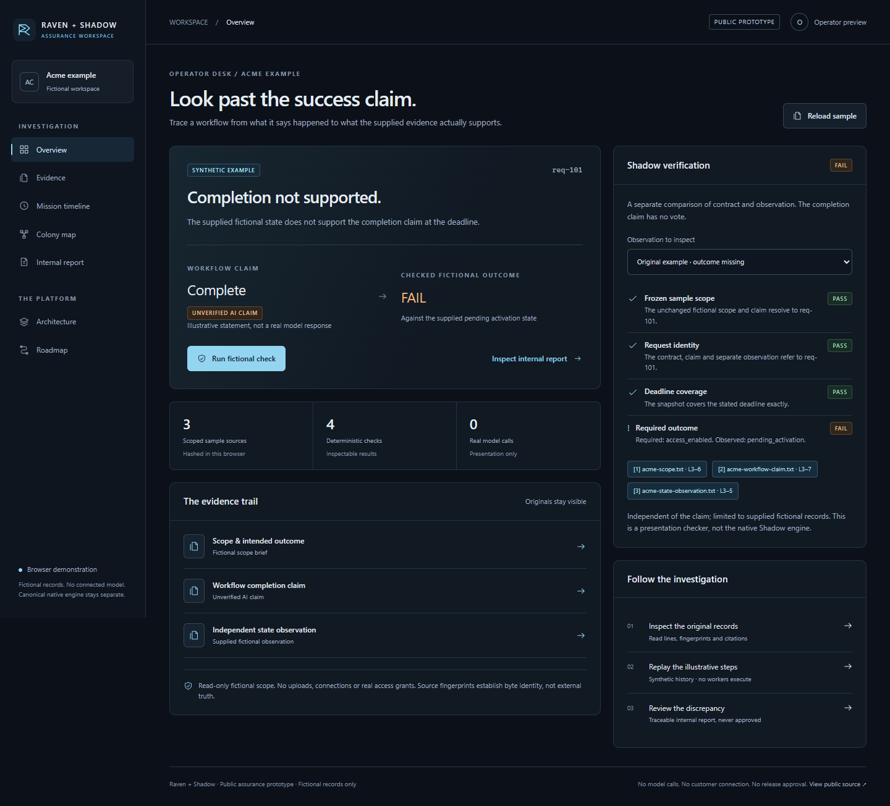
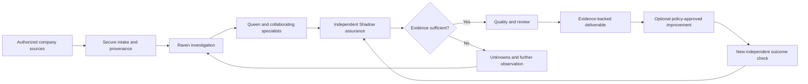

# Raven + Shadow

**Evidence-first AI investigations, workflow assurance, and verified operations.**

> **Project status — October 30, 2026:** A browser-based **Assurance Prototype** for a fictional Acme investigation. It demonstrates evidence navigation and a deterministic fictional outcome check. Native-engine qualification is separate and is not established by this public prototype. **No live agents, customer service, production certification or autonomous repair is represented.**

## Founder cockpit candidate — local review

The isolated `prototype/founder-cockpit-audit` branch adds a Command Center and one
Engagement view: the fixed question, deadline, source scope, current sample stage,
next permitted action and separate assurance/release states. A deterministic Raven
briefing links explanations to source evidence; it is not a live conversation.
The existing map explains illustrative role inputs/outputs, and the operations
panel states which real connections and records are unavailable.

The candidate passes **34/34 unit checks**, **37/37 founder browser checks** and
**37/37 existing browser regression checks** in installed Edge. Verified repairs
cover intake retry, timeline keyboard focus, failed source preparation, cancelled
reload recovery and source/report download retry without losing the bound result.
[Final evidence](tests/founder/acceptance-manifest.json) ·
[Source and historical-file preservation](tests/founder/final-preservation.json).

The public URL below still serves the earlier presentation from
`prototype/assurance-workspace`; this candidate has not been deployed. The same
local launch command runs the checked-out branch.
[Founder walkthrough](docs/PROTOTYPE.md#founder-cockpit-candidate) ·
[Actual audit and retained failures](docs/FOUNDER_COCKPIT_AUDIT.md) ·
[Pilot blockers and future interface boundary](docs/FOUNDER_BUSINESS_READINESS.md).

[Candidate Command Center](tests/founder/regression-verified/screenshots/dashboard-desktop.png) ·
[Engagement and separate assurance gates](tests/founder/after-final/e-satisfied-engagement.png) ·
[Mobile founder view](tests/founder/after-final/mobile-command-center.png) ·
[Before/after comparison](docs/FOUNDER_COCKPIT_AUDIT.md#before-and-after-browser-evidence).

## Try the Assurance Prototype

**[Open the live Raven + Shadow Assurance Prototype](https://christopher-kiser.github.io/raven-shadow/)**

Published over HTTPS on GitHub Pages from the isolated
`prototype/assurance-workspace` branch. [Public PR #9](https://github.com/christopher-kiser/raven-shadow/pull/9)
remains open and unmerged. This is the fictional presentation only; the native
engine and customer systems are not connected.

The demonstration follows one question: **a workflow says it succeeded—did the
required state actually exist at the deadline?** Load the fictional Acme case,
inspect the supplied sources and citations, replay the labeled example timeline,
run the browser's deterministic check, and inspect or export the internal report.
Change the observation to understand why a result becomes `PASS`, `FAIL` or
`NOT ASSESSED`.

From this repository, run:

```sh
python -m http.server 4173 --bind 127.0.0.1
```

On Linux/WSL installations that name the executable `python3`, use `python3`
in place of `python`.

Then open [http://127.0.0.1:4173](http://127.0.0.1:4173). No package installation,
model download, API key or backend is needed. See the [prototype guide](docs/PROTOTYPE.md)
for the walkthrough, proof boundaries, tests and static-hosting status.

| Works in this public prototype | Deliberately outside this prototype |
| --- | --- |
| Load the built-in fictional source set and inspect exact citations | Customer uploads, connectors and authenticated access grants |
| Replay a clearly labeled synthetic investigation history | Real model calls, actual worker messages or native event replay |
| Compare a selected fictional observation with a fixed outcome contract | Authenticated external business observations or canonical Shadow execution |
| Inspect and download an internal demonstration report | Quality/Queen approval, customer release or production changes |
| Explore the intended architecture and gated roadmap | A second Store, Queen, agent scheduler or assurance backend |

The default Acme result is **FAIL**: the required state was not observed at the
deadline. Detecting a discrepancy does not establish its cause or fix the workflow.
A changed observation is an explicitly hypothetical variant; it never rewrites the
original case. Every example remains fictional and every report remains unapproved.

## Verified published baseline experience

The deterministic example tests pass **12/12**. The final real-browser acceptance
run in installed Microsoft Edge passes **37/37** checks at desktop, tablet and
mobile sizes. Checks cover source/citation navigation, all four observation
variants, report download integrity, replay controls, keyboard/dialog behavior,
reduced motion and stale-result handling. The tested app made no external requests,
backend writes or WebSocket connections and raised no uncaught browser errors.
A separate **7/7 hosted Edge smoke check** verified the published assets, sample
intake, discrepancy check, report download/hash, citations and mobile navigation.
[Repository validation also passed](https://github.com/christopher-kiser/raven-shadow/actions/runs/41097872551).
These are presentation checks, not native-engine or accessibility certification.
[Results and reproduction](docs/PROTOTYPE.md#validation) ·
[Hosted smoke receipt](tests/public-smoke-results.json) ·
[Deployment receipt](tests/deployment-results.json).



[Evidence viewer](tests/screenshots/evidence-desktop.png) ·
[Inspectable report](tests/screenshots/report-desktop.png) ·
[Crown-free example colony](tests/screenshots/colony-desktop.png) ·
[Tablet architecture](tests/screenshots/architecture-tablet.png) ·
[Mobile dashboard](tests/screenshots/dashboard-mobile.png)

## Previously published engineering evidence

The following dated results are historical software evidence. They are not new
native-engine tests performed by this presentation workstream. The
[current state](docs/CURRENT_STATE.md) separates the public prototype from earlier
private engineering milestones.

**Initial campaign baseline:** native audit baseline reproduced (416 tests: 413 pass, 3 skip); separate staging baseline reproduced (153 pass). [Current evidence and limits](docs/CURRENT_STATE.md) supersede historical staging status below.

**Campaign 003:** legacy intake consolidation is tested on Windows and WSL (489 tests each), with 14 real-browser checks. RS-002 and native business qualification remain incomplete. [Current evidence and limits](docs/CURRENT_STATE.md).

## Why we're building it

AI systems can report that they completed work even when the intended business outcome never happened. Businesses need more than a plausible explanation: they need a traceable investigation, independently checked evidence, an accountable decision, and a way to verify whether a change truly improved the outcome.

**Raven + Shadow** is being developed to make that process repeatable. Raven helps an operator understand and investigate a business problem. Queen coordinates scoped specialist workers. Shadow independently evaluates consequential claims against authorized evidence. The platform prepares transparent reports and, eventually, can propose and execute reversible corrections within explicit customer policies.

## Intended product journey



The target experience includes one founder/operator workspace, permission-aware company engagements, a contextual Raven conversation, evidence and decision timelines, and a living neural map showing **real recorded** worker relationships and handoffs. The visualization comes after the underlying infrastructure; it must not impersonate agent activity.

## The two central components

| Component | Role | Non-negotiable boundary |
| --- | --- | --- |
| **Raven** | Founder-facing reasoning guide; explains missions, evidence, Queen decisions, and options | Source citations demonstrate what was submitted, not whether a submitted claim is true |
| **Queen and specialists** | Coordinate scoped investigations; spawn authorized child workers; exchange attributable, durable messages | No independent permission escalation or unchecked production actions |
| **Shadow** | Independent claim/outcome verification using an appropriate evidence and proof contract | An unobserved effect is **not verified**; disagreement or missing evidence does not become PASS |
| **Archive and Quality** | Retain provenance, prevent unsupported reports, propose safe cleanup of identified generated artifacts | Founder-authored originals cannot be deleted; Archive cleanup requires Queen approval |

## Historical implementation register and remaining work

| Capability | Status | Evidence / limitation |
| --- | --- | --- |
| Fictional company-package intake and local evidence hashing | **Local staging implemented** | Synthetic, non-sensitive source package with immutable/hash-checked evidence |
| Durable five-stage mission execution, task workers, peer handoffs, retry/recovery | **Local staging implemented** | Tasks and messages persisted; tests cover restart, duplicates, leases, and failure handling |
| Independent Shadow check on a synthetic false-success case | **Local staging implemented** | Correct outcome `FAIL`; it is an offline supplied fixture, not a live customer observation |
| Internal evidence-backed draft report | **Local staging implemented** | Hash-checked report; not approved for external release |
| Automated test suite | **153 tests passing on extracted v0.7 package (Oct 29, 2026)** | 79 workbench + 74 operator/runtime tests on Python 3.13.5 in this environment |
| Native reuse audit and read-only source adapter | **Audit complete; isolated private feature tested** | Existing canonical components mapped; 20 added tests pass. Authenticated runtime activation and business qualification remain pending |
| Real customer connectors and production identity/security | **Not available** | No confidential intake, customer portal, or production permissions |
| Autonomous production remediation and self-optimization | **Future, gated** | Requires scoped authority, isolated tests, independent verification, canary/rollback, and audit |
| Windows hardware qualification | **Pending** | Package has Windows launchers, but the current verification was not performed on Windows hardware |

## What the first real offer could be

A **Shadow Assurance Assessment** for one precisely defined business workflow: agree on a measurable outcome, inspect authorized records, compare claimed and observed results, deliver a reviewed discrepancy report, and recommend a bounded next step. This is a **proposed offer**; pricing and demand are not yet validated. Larger automation and ongoing monitoring services would follow only after the assurance workflow proves reliable.

## Development roadmap

1. **Repository, architecture and evidence baseline** — publish truthful project documentation; keep private runtime code separate.
2. **Native integration audit** — identify and reuse Raven's canonical Store, Queen, model router, authorizations and Shadow verifier; avoid duplicate infrastructure.
3. **Qualified real reasoning + read-only verification** — investigate a new non-sensitive case using documented source links and an independent outcome observation.
4. **Permissioned pilot** — customer isolation, security, owner review, report quality and operational runbooks.
5. **Controlled improvements** — reversible proposals, isolated evaluation, independently verified outcomes and explicit authorization.
6. **Product experience and business operations** — refine the Raven conversation, real-time colony view, client portal, customer delivery, support and sustainable pricing.

The order is intentional: **design from the customer outcome downward, build from the trust infrastructure upward.**

## Documentation

- [Product and infrastructure pyramid](docs/PRODUCT_BLUEPRINT.md)
- [Target founder workspace and client portal](docs/OPERATOR_WORKSPACE.md)
- [Build milestones and acceptance gates](docs/ROADMAP.md)
- [Cumulative feature register](docs/REQUIREMENTS.md)
- [Current technical evidence and limitations](docs/CURRENT_STATE.md)
- [GitHub / Hugging Face resource strategy](docs/REUSE_STRATEGY.md)
- [Business operating model and first paid offer](docs/BUSINESS_MODEL.md)
- [Fictional demonstrator](docs/DEMO.md)
- [Repository setup and security practices](docs/REPOSITORY_SETUP.md)
- [Security policy](SECURITY.md)

## Public-repository boundary

This repository is intended as a **public project showcase, fictional presentation prototype and roadmap**, not a release of the native Raven installation, customer data, private models, business credentials or unreleased source. There is currently **no open-source license grant** for the underlying implementation. Public visibility is not permission to repurpose proprietary source. Real deployment availability and commercial terms have not been announced.
