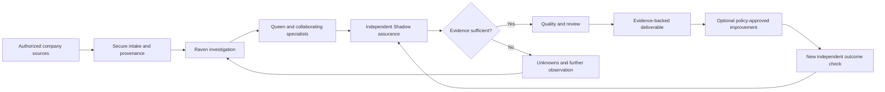

# Raven + Shadow

**Evidence-first AI investigations, workflow assurance, and verified operations.**

> **Project status — October 29, 2026:** Local, offline, non-sensitive staging prototype; private native-system integration and pre-pilot qualification are pending. **Not a production customer service, security certification, or autonomous repair system.**

**Current campaign:** native audit baseline reproduced (416 tests: 413 pass, 3 skip); separate staging baseline reproduced (153 pass). [Current evidence and limits](docs/CURRENT_STATE.md) supersede historical staging status below.

## Why we're building it

AI systems can report that they completed work even when the intended business outcome never happened. Businesses need more than a plausible explanation: they need a traceable investigation, independently checked evidence, an accountable decision, and a way to verify whether a change truly improved the outcome.

**Raven + Shadow** is being developed to make that process repeatable. Raven helps an operator understand and investigate a business problem. Queen coordinates scoped specialist workers. Shadow independently evaluates consequential claims against authorized evidence. The platform prepares transparent reports and, eventually, can propose and execute reversible corrections within explicit customer policies.

## Intended product journey

The target experience includes one founder/operator workspace, permission-aware company engagements, a contextual Raven conversation, evidence and decision timelines, and a living neural map showing **real recorded** worker relationships and handoffs. The visualization comes after the underlying infrastructure; it must not impersonate agent activity.

## The two central components

| Component | Role | Non-negotiable boundary |
| --- | --- | --- |
| **Raven** | Founder-facing reasoning guide; explains missions, evidence, Queen decisions, and options | Source citations demonstrate what was submitted, not whether a submitted claim is true |
| **Queen and specialists** | Coordinate scoped investigations; spawn authorized child workers; exchange attributable, durable messages | No independent permission escalation or unchecked production actions |
| **Shadow** | Independent claim/outcome verification using an appropriate evidence and proof contract | An unobserved effect is **not verified**; disagreement or missing evidence does not become PASS |
| **Archive and Quality** | Retain provenance, prevent unsupported reports, propose safe cleanup of identified generated artifacts | Founder-authored originals cannot be deleted; Archive cleanup requires Queen approval |

## Verified progress vs. remaining work

| Capability | Status | Evidence / limitation |
| --- | --- | --- |
| Fictional company-package intake and local evidence hashing | **Local staging implemented** | Synthetic, non-sensitive source package with immutable/hash-checked evidence |
| Durable five-stage mission execution, task workers, peer handoffs, retry/recovery | **Local staging implemented** | Tasks and messages persisted; tests cover restart, duplicates, leases, and failure handling |
| Independent Shadow check on a synthetic false-success case | **Local staging implemented** | Correct outcome `FAIL`; it is an offline supplied fixture, not a live customer observation |
| Internal evidence-backed draft report | **Local staging implemented** | Hash-checked report; not approved for external release |
| Automated test suite | **153 tests passing on extracted v0.7 package (Oct 29, 2026)** | 79 workbench + 74 operator/runtime tests on Python 3.13.5 in this environment |
| Authenticated native Raven/Queen/Store integration | **Pending** | Protected native installation not yet adapted or qualified |
| Real customer connectors and production identity/security | **Not available** | No confidential intake, customer portal, or production permissions |
| Autonomous production remediation and self-optimization | **Future, gated** | Requires scoped authority, isolated tests, independent verification, canary/rollback, and audit |
| Windows hardware qualification | **Pending** | Package has Windows launchers, but the current verification was not performed on Windows hardware |

## What the first real offer could be

A **Shadow Assurance Assessment** for one precisely defined business workflow: agree on a measurable outcome, inspect authorized records, compare claimed and observed results, deliver a reviewed discrepancy report, and recommend a bounded next step. This is a **proposed offer**; pricing and demand are not yet validated. Larger automation and ongoing monitoring services would follow only after the assurance workflow proves reliable.

## Development roadmap

1. **Repository, architecture and evidence baseline** — publish truthful project documentation; keep private runtime code separate.
2. **Native integration audit** — identify and reuse Raven's canonical Store, Queen, model router, authorizations and Shadow verifier; avoid duplicate infrastructure.
3. **Qualified real reasoning + read-only verification** — investigate a new non-sensitive case using documented source links and an independent outcome observation.
4. **Permissioned pilot** — customer isolation, security, owner review, report quality and operational runbooks.
5. **Controlled improvements** — reversible proposals, isolated evaluation, independently verified outcomes and explicit authorization.
6. **Product experience and business operations** — refine the Raven conversation, real-time colony view, client portal, customer delivery, support and sustainable pricing.

The order is intentional: **design from the customer outcome downward, build from the trust infrastructure upward.**

## Documentation

- [Product and infrastructure pyramid](docs/PRODUCT_BLUEPRINT.md)
- [Target founder workspace and client portal](docs/OPERATOR_WORKSPACE.md)
- [Build milestones and acceptance gates](docs/ROADMAP.md)
- [Cumulative feature register](docs/REQUIREMENTS.md)
- [Current technical evidence and limitations](docs/CURRENT_STATE.md)
- [GitHub / Hugging Face resource strategy](docs/REUSE_STRATEGY.md)
- [Business operating model and first paid offer](docs/BUSINESS_MODEL.md)
- [Fictional demonstrator](docs/DEMO.md)
- [Repository setup and security practices](docs/REPOSITORY_SETUP.md)
- [Security policy](SECURITY.md)

## Public-repository boundary

This repository is intended as a **public project showcase and roadmap**, not a release of the native Raven installation, customer data, private models, business credentials or unreleased source. There is currently **no open-source license grant** for the underlying implementation. Public visibility is not permission to repurpose proprietary source. Real deployment availability and commercial terms have not been announced.
