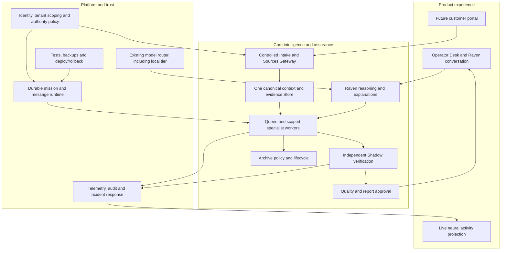

# Product architecture: design top-down, build bottom-up

This is the product contract that engineering must satisfy. It describes the **intended business**, not a statement that the entire platform exists today.

## A day in the finished product

**Founder/operator:** Open Raven, select a client, inspect current engagement and alerts, ask a question in the top-fed conversation, authorize an investigation, observe actual Queen-to-worker messages in the neural view, compare Raven's research with Shadow's independent assessment, inspect the evidence chain, approve or reject a reversible improvement, and deliver a reviewed report. Raven should stay in the same inquiry as follow-up questions and decisions.

**Customer:** Sign in to their organization workspace, approve a narrow scope, grant time-limited read-only access or upload approved sources, see exactly what the system can access, review the findings and unknowns, approve consequential actions when authorized, receive a report and see outcomes over time. The customer should not need to understand the internal agent hierarchy.

**Independent reviewer:** Reproduce the applicable proof, inspect original evidence and captured observations, see who or what made each claim, detect missing evidence, and withhold certification on insufficient proof.

## The product pyramid

We **decompose the vision from the top downward** so every subsystem has a business reason. We **implement from the bottom upward** so critical promises rest on reliable systems.

| Level (top → bottom) | What the finished business needs | Definition of done |
| --- | --- | --- |
| **7. Customer outcome** | A verified answer to a specific operational question, a trustworthy improvement decision, and measurable value | Report states observed effect, proof class, source links, uncertainty, owner approval and next action |
| **6. Commercial operation** | Customer discovery, defined offer, sales pipeline, proposals, scope, contracting, billing, onboarding, support and renewal | One legally authorized, secure, repeatable paid engagement can be delivered and supported |
| **5. Product experience** | Operator Desk + Raven conversation; customer portal; approvals; live worker/evidence map; delivery and monitoring | A buyer and operator can complete the agreed workflow without inspecting internal files |
| **4. Business workflows** | Intake → inventory → investigate → verify → review → propose correction → verify again → report/monitor | Every step has an explicit input, output, owner, refusal condition and audit event |
| **3. Domain engines** | Source gateway, canonical context, Raven and Queen, worker specialists, independent Shadow, Quality, Archive, reporting, change assurance | Each engine has typed contracts, least-privilege tools and tests against false completion |
| **2. Runtime and trust services** | Durable tasks and messages, model router, shared context, source provenance, identity/permissions, evaluation, security controls, observability | Crash/replay, tenant isolation, forged evidence and unsupported claims fail safely |
| **1. Core foundation** | Version-controlled code, deployment/environment isolation, secure storage, credentials, backups/recovery, test automation, auditability | Reproducible deployments, working recovery drill, secret protection, traceable changes |

**Key architectural rule:** The agent graph is a projection of canonical work/evidence events. It is not a second colony brain or a source of truth.

## System boundaries

The diagram illustrates intended integration paths. It does not imply those production connections already exist.

## Essential contracts

1. **Tenant and authority:** Every input, mission, source, worker, tool, result and approval belongs to a specific customer/tenant and explicit permission scope. The content of a source cannot authorize a tool.
2. **Evidence and provenance:** Preserve source bytes/hash/origin/time, distinguish assertions from observations, and attach evidence refs to claims. Hash consistency alone is not truth.
3. **Worker collaboration:** Queen may delegate children under specialist parents; peer messages carry mission identity, sender/recipient, correlation, acknowledgments, limits and audit history. Workers cannot escalate their own privileges.
4. **Assurance:** Shadow does not simply ask the same model whether its answer is correct. It independently checks a defined proof class and outcome. Use `PASS`, `FAIL`, and `NOT ASSESSED` (or typed equivalent) honestly.
5. **Self-recovery:** Retry safe idempotent stages with leases, fencing, backoff, deadlines, circuit breaking, dead-letter escalation and bounded resources. Never guess success after an unknown external outcome.
6. **Controlled evolution:** Agents can propose a new skill, worker route or repair. Promote only after tests, independent checks, permission/expense policy, rollback and approval when required.
7. **Archive:** Tag agent-generated artifacts distinctly; Archive proposes cleanup of safe, positively identified unneeded generated artifacts and obtains Queen approval. Never delete founder or customer originals as routine cleanup.
8. **Communication and interface:** Raven remains the conversational narrator/guide, eventually with optional consent-based messaging/calls. The neural graph uses real events, not staged messages.
9. **Enterprise operation:** Auth, encryption/key management, backups, logging, retention, disclosure, incident response, service boundaries, customer agreements, billing, support and deployment isolation must be qualified before taking live confidential data.

## What not to build twice

Before adding a framework, database, queue, memory index, model router or UI: **audit the native Raven/Shadow source and label the candidate `REUSE`, `ADAPT`, `MISSING` or `REJECT`** with rationale. The standalone v0.7 console provides reference contracts but must not become a competing permanent native Store.

## Narrow initial wedge

Start with a **human-reviewed assurance assessment of a single AI-assisted workflow** where reported success can diverge from independently observable state. Plausible examples include support ticket closure, onboarding completion or provisioning. This is a focus hypothesis, not an asserted market winner. Expand sectors only after a demonstrably trustworthy and repeatable workflow.
